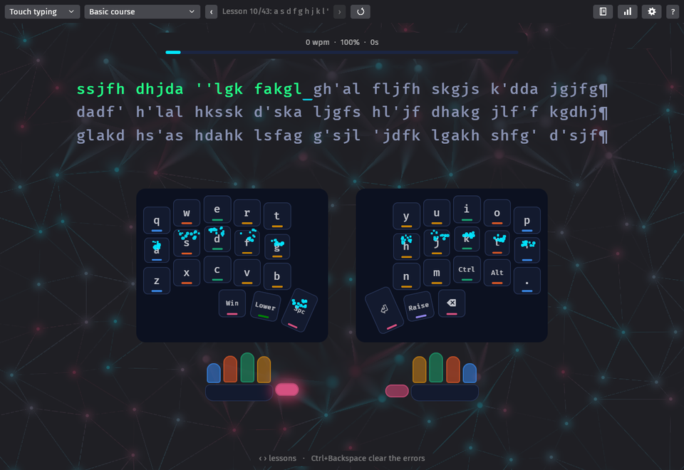
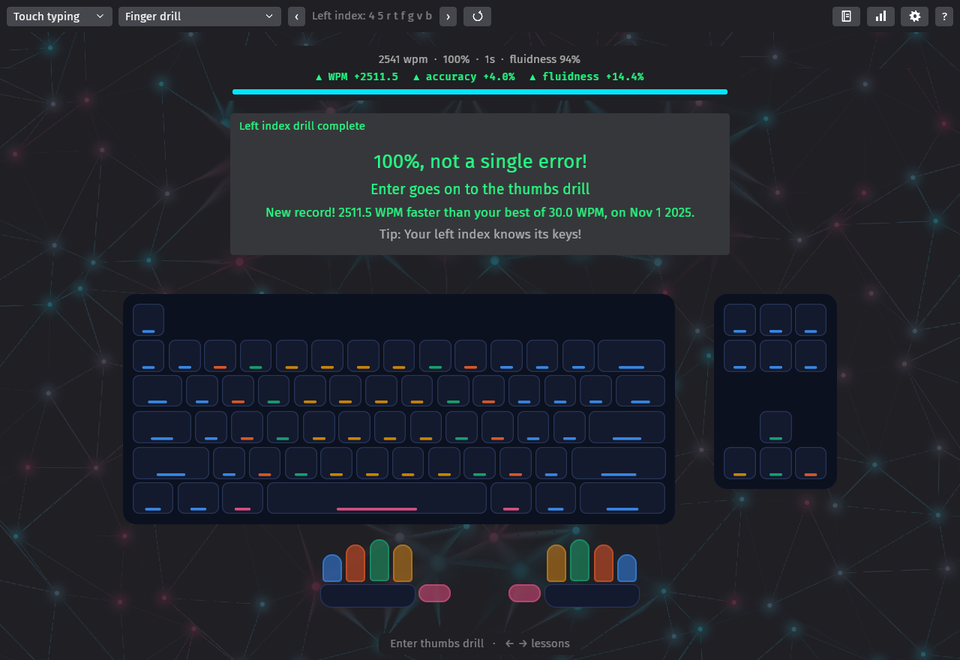
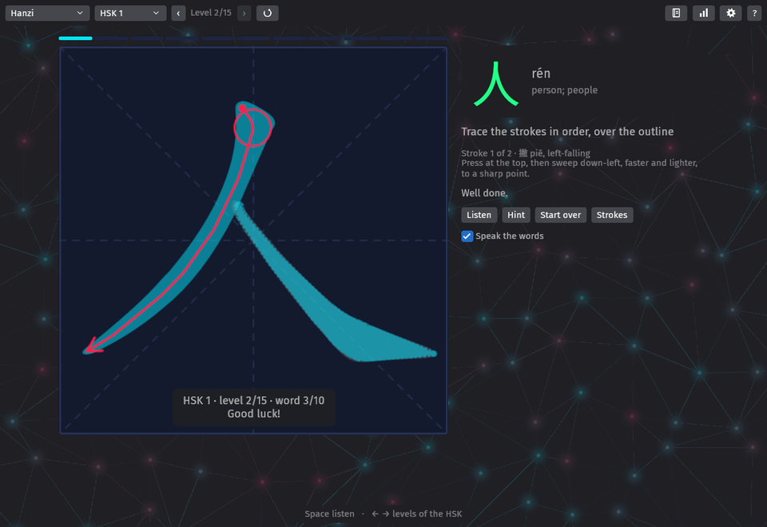
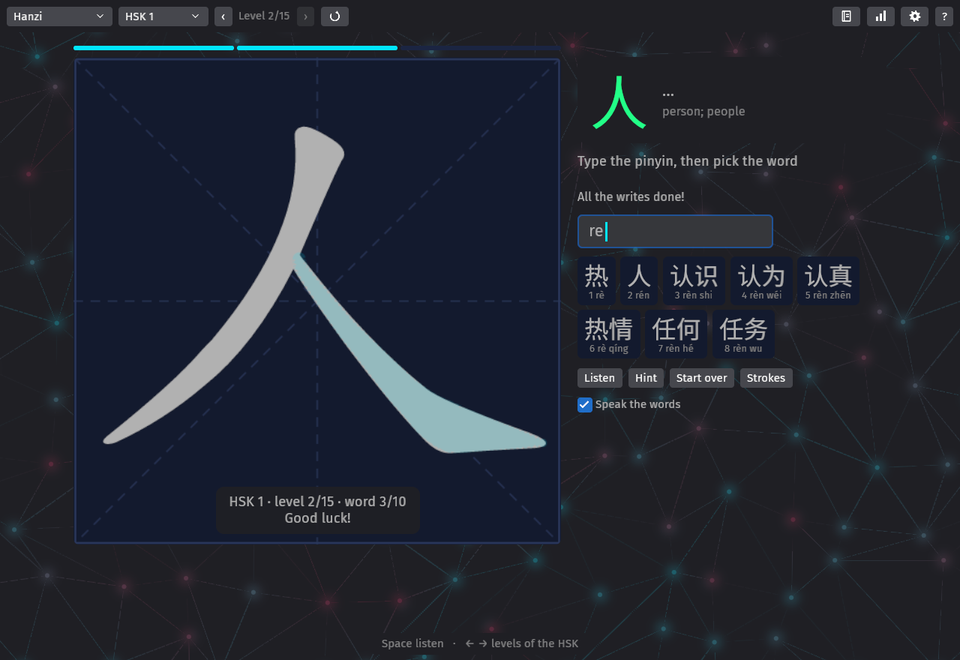
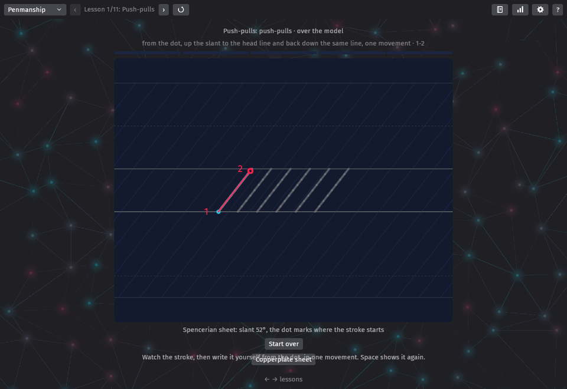
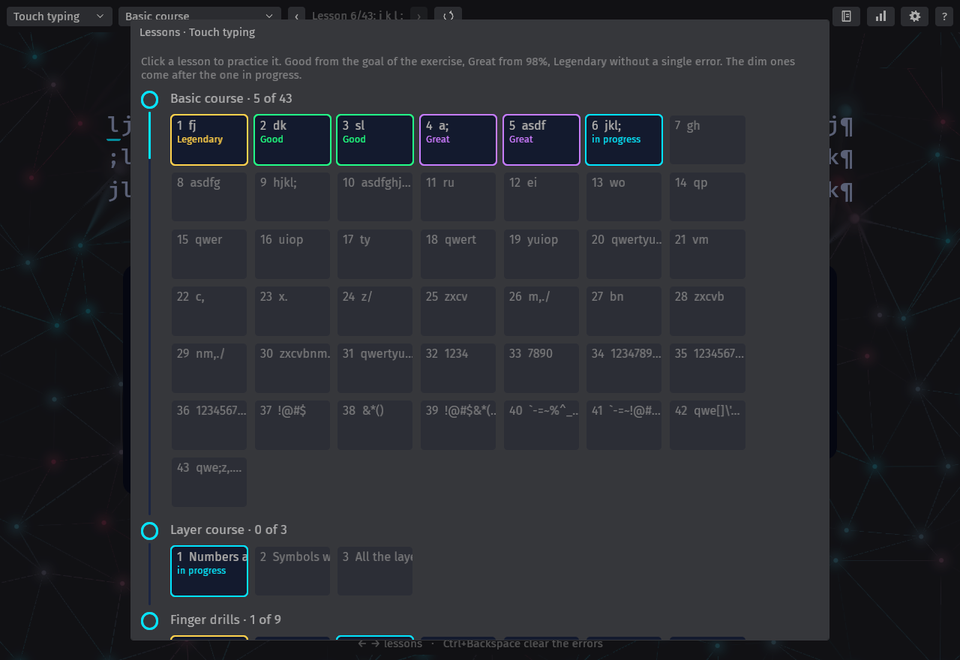

# Claudralingo

A typing tutor made with [Bevy](https://bevyengine.org) 0.20 and its
[feathers](https://docs.rs/bevy_feathers/0.20.0) widgets. It runs natively and in the browser:
**play it at [sebosp.github.io/claudralingo](https://sebosp.github.io/claudralingo/)**, the
progress stays in the browser.

| Platform        | How to get it                                                                                                       |
| --------------- | ------------------------------------------------------------------------------------------------------------------- |
| Web             | [sebosp.github.io/claudralingo](https://sebosp.github.io/claudralingo/), a browser with WebGPU or WebGL2, built from `main` |
| Linux x86_64    | `claudralingo-linux-x86_64.tar.gz` of the [releases](https://github.com/sebosp/claudralingo/releases), or the Arch packages, see [Install on Arch Linux](#install-on-arch-linux) |
| Android (arm64) | `claudralingo-android-arm64.apk` of the releases (a debug signature: allow the unknown source)                     |
| iOS             | the simulator build of the releases; a device needs an Apple signing identity, the project is in `mobile/`          |
| Windows x86_64  | `claudralingo-windows-x86_64-setup.exe` of the releases, an installer (unsigned: Windows asks to confirm the unknown publisher) |
| macOS           | from the sources with cargo, see [Build](#build); no build is published yet                                         |

## Screenshots

A basic lesson on the Corne, the next key green on the keyboard, the fingers striped in their
colors:



The end of a finger drill: the summary says how it went and where Enter goes, green on to the
next lesson, amber the same one again:



A hanzi word: the bar of its writes over the drawing, the brush guide of the next stroke, the
word glowing once a write is done; then the pinyin in its field:





The penmanship: the push-pulls on the Spencerian sheet, the pen writing the stroke before the
eyes with the counts 1 and 2 of the copybooks:



The lessons on their path, graded Good, Great or Legendary, the ones ahead dim:



## Roadmap

1. **Touch typing.** The exercises and the tutor logic of
   [Klavaro](https://sourceforge.net/projects/klavaro/) 3.14, ported to Rust, on an on-screen
   keyboard: a row staggered QWERTY, the split Corne 3x5+3 and 3x6+3, the Lily58, or your own
   ZMK keymap, with layers.
2. **Chinese hanzi (now, HSK 1 to 4).** The words written stroke by stroke with a pen, a mouse or
   a finger, then typed in pinyin, see [Hanzi](#hanzi).
3. **Penmanship (now, the small letters).** Spencerian script and Copperplate on their guide
   sheets, see [Penmanship](#penmanship). What comes next is in `TODO.md`.

## Menus and toolbar

The first menu of the toolbar is what you learn, Touch typing, Hanzi or Penmanship; the second
one its exercise (touch typing) or its HSK level and the weak words (hanzi). ‹ › go through the
lessons of the exercise: the basic or the layer lesson, the finger, the hand of the bounces, the
level within the HSK level. They are grayed out at the ends, before a locked lesson and in the
exercises without lessons. Then the icons: the circling arrow (F5) starts the text, the word or
the figure again, the notebook opens the lessons and the bars the stats (those of the first
menu), the gear the settings, `?` the help. The app opens on the exercise of the last session.

The bar at the bottom shows the keys of the moment. At the end of a typing exercise it is empty,
the summary says where Enter goes; in the hanzi and the penmanship the key to go on with appears
after a pause of five seconds: whoever knows it has pressed it by then. The help (`?` or F1) lists
every shortcut.

The setting "Hide the toolbar" puts it over the top of the window, it shows when the pointer goes
to the top or touches it; F11 is the full screen, the toolbar hides there too. Zoomed in, the
settings, the help and the other panels scroll inside the window.

## Touch typing

The four Klavaro exercises, with their original texts and goals, and two of Claudralingo:

| Exercise         | Text                                                       | Goal                               |
| ---------------- | ---------------------------------------------------------- | ---------------------------------- |
| Basic course     | 43 lessons of random 5-letter "words" of a few keys        | 95% accuracy to unlock the next    |
| Adaptability     | random weird words, made of your worst keys when needed    | 98% accuracy                       |
| Velocity         | random words of Klavaro's dictionary                       | 95% accuracy, 50 WPM               |
| Fluidness        | paragraphs of a text                                       | 97% accuracy, 50 WPM, 70% fluidity |
| Finger drill     | the keys of one finger, up and down its column, four lines | 95% accuracy, Enter: the next finger |
| Finger bounce    | middle and index of one hand in turns, alternating case    | 95% accuracy, slower is expected   |
| Shortcuts & keys | Esc, editing shortcuts, arrows, numbers, symbols, Alt+Tab  | every key on the first try         |

Differences to Klavaro:

- **Backspace works in every exercise.** Klavaro only allows it in the fluidness exercises
  (`tutor_eval_forward_backward`), the other ones beep. As in Klavaro's fluidness, a wrong key
  moves forward and blocks the progress until the errors are erased, only the errors can be
  erased, and the characters retyped after a correction count as errors. Ctrl+Backspace erases
  all the errors.
- The first key starts the timer, there is no "press any key" intro.
- The misses and touch times are recorded in the basic course too.
- At the end of an exercise Enter starts the next one, Backspace goes back one basic lesson, as in
  Klavaro. A basic lesson at 95% or more unlocks the next one by itself, as in Klavaro.
- The end of an exercise shows how it went: fireworks for a perfect one, sparkles when the goal is
  reached, and when it is not, the most missed keys red and breathing on the keyboard (with their
  characters, on any layer) until the next exercise, named in the summary too. Reduce motion
  keeps the red keys still and skips the fireworks.

The basic lessons are masks over the 4x14 key grid of Klavaro's `qwerty_us.kbd`, their characters
are the same for both layouts: on the Corne the digits and most symbols are on the layers.

### The keyboard on the screen

The next key is green, the shift to hold purple, the layer and the modifier keys to hold amber
(with the legends of that layer), backspace red while there are errors to erase. The stripe at
the bottom of each key is the finger that types it. The hands under the keyboard have the same
colors: the finger of the next key lifts and glows, the fingers holding a shift, a layer or a
modifier key are outlined in amber.

- **Fade legends** (on by default): every exercise starts with the legends and the hints shown,
  they fade out over the first 20 correct keys, only the layout and the finger colors stay. A
  wrong key, or a pause of 2 seconds, shows the next key again, green and with its legend, until
  it is typed. That is the way to learn a new layout (Dvorak, Colemak, a Corne keymap): from
  memory, with help only when stuck.
- **Layer trainer** (on by default): a character of another layer, or a chord with Ctrl, Alt or
  Super, always shows the keys to hold and the key to press, with the instructions above the
  keyboard, i.e. "Hold Lower (left thumb), then press ! where A is (left pinky, home row)".

### Colors, background and settings

The finger colors and the colors of the Lower and Raise layers are the validated categorical
palette of the dataviz reference (blue, orange, aqua, yellow, magenta for the pinky to the thumb,
green for Lower, violet for Raise), in the order of the physical neighbors: neighboring fingers and
the thumb layers stay apart for the color blind (CVD ΔE ≥ 8.4) and for normal vision (ΔE ≥ 19).
Red stays the erase hint. The colors are never alone: the legends and the texts name the fingers
and the layers.

The background is the edges of a slowly drifting low poly mesh, its triangles join and dissolve.
Its vertices wear the colors of the most missed keys: the finger color, or the layer color when the
key is on Lower or Raise; "Focus" under "Your keys" names them. Under the text to type and the
hands the lines blur away.

Settings (toolbar): the keyboard, dark mode, the background (off, subtle, lively), fade legends,
layer trainer, the hands, reduce motion (no drift, sparks, shakes nor breathing keys), a large
text to type and the zoom. By default the window is scaled to fit its size, a big screen shows
everything bigger; the zoom adds to that (50% to 300% in all, saved) with the buttons, Ctrl and the
mouse wheel, a trackpad pinch, Ctrl+= Ctrl+- Ctrl+0 (in the browser its own zoom does that). The
wheel scrolls the window when it does not fit.

Basic course on a split keyboard: the lessons of Klavaro pick the keys by their QWERTY place, the
Corne takes the places of the keys under the same fingers, so the lessons train its base layer
first (lesson 4 is `a '`, the home row pinky); the number row and the symbols come in the later
lessons, on the layers. A modifier in a place (Ctrl where QWERTY has `,`) brings the home keys of
the fingers instead. The layer trainer highlights a layer combination on the keyboard, the words
above it are for the auto shift and the modifiers.

Lessons (toolbar): the 43 lessons of the basic course with the best and the last accuracy and the
times typed, green when the best reached 95%, red below; a click practices a lesson again. The
progress is saved in `~/.config/claudralingo/progress.json` (in the browser, its local storage).

At the end of an exercise the accuracy is green when the goal is reached, red otherwise. A line
typed without an error clears like a row of Tetris with a small firework; a perfect exercise ends
with fireworks, sparks and congratulations.

### Finger drills

One drill per finger, ‹ and › pick the finger: the pinky goes up and down its column (q a z), the
index fingers also move sideways between their two columns, the thumbs drill is short words
between Space and Enter. A drill passed at 95% goes on to the next finger with Enter, as the
lessons do, a failed one is repeated. At the end of the other exercises, a key missed 3 times or more, or a
finger below 92% accuracy over all the exercises, suggests the drill of that finger: Tab or the
button starts it. The weakest fingers are listed under the keyboard.

### Finger bounce

"Left hand finger bounce" and "Right hand finger bounce" train the independence of the middle and
the index fingers, ‹ › switch the hand. The middle finger presses its top row key, the index runs
down its home column (top, home, bottom row), the middle finger goes down one row, the index runs
again, then the same for the inner column of the index: `eRfV DrFv cRfV EtGb dTgB CtGb` on the
left hand. The next lines bounce in a random order. The case alternates on every letter: on the
Corne every other key is held a moment longer for its auto shift, the speed drops, that is part
of the exercise.

### Shortcuts & keys

A round of 21 tasks, each one a key or a chord to press, with the keys to hold shown on the
keyboard (the shift of the symbols is part of the symbol):

- Esc;
- a line of text with a cursor, where the shortcuts do what they do in an editor: Home, Ctrl+→,
  Ctrl+Shift+→ to select a word, Ctrl+C, End, Ctrl+V, Ctrl+Z, Ctrl+Shift+←, Ctrl+X,
  Ctrl+Backspace, Backspace, Ctrl+A, Delete;
- the arrows, the ten digits and ten random symbols, like `. / @ # $ % ^ & * ( ) { } ? + = \ -`,
  in a random order;
- Tab and Shift+Tab;
- Alt+Tab to another window and back: the window notices that it lost the focus with Alt held,
  and times the round trip until it has the focus again. The best round trip is saved.

A wrong chord changes nothing, it counts as a miss of the task and the chord is shown again.

### The Corne keymap

The Corne 3x5+3 is the default 5 column keymap of the Typeractive wireless Corne
(<https://docs.typeractive.xyz/build-guides/corne-wireless/firmware>, `config/corne.keymap` of
[corne-wireless-5-col-zmk-config](https://github.com/typeractivexyz/corne-wireless-5-col-zmk-config)),
read from its ZMK bindings by `src/zmk.rs`, with the key positions of ZMK's
`foostan_corne_5col_layout`: the column stagger, the inner thumbs 1.5 keys tall and turned by 12°
and 24°.

- Base: QWERTY with auto shift (a key held a moment longer types its shifted character, the key
  turns purple), `' .` on the right pinky, Ctrl and Alt on the right bottom row;
- thumbs: `GUI Lower Space` on the left, `Enter Raise Backspace` on the right;
- Lower: `! @ # $ % ^ & * ( )`, the Bluetooth profiles, the arrows on H J K L, Esc and Tab on the
  right thumbs;
- Raise: the digits, `- = { [ ( ) ] } / \`, `` ` , : ; . ``, Esc on the left thumb, Tab on the
  right one.

The keyboard on the screen is an on-screen keyboard too: a click types the key, a long press
(200 ms, the tapping term of the auto shift) types it shifted. A click on Lower or Raise shows
and uses its layer until the next click, holding it uses the layer while held (with a second
finger on a touch screen). The keys that only fall through to the base layer (`&trans`, like the
right pinky `.` on Raise, next to the `.` of Raise on M) are dimmed. When the next key is not on
the layer shown, the hint points at the layer key to click, not at the key that types something
else there. A click on Ctrl, Alt, Win or Shift applies it to the next clicked key: the clicks
only make key presses for the game, nothing is sent to the system, Win does not open its menu. The keymap has no Shift, Home, End nor Delete key: the shortcuts round uses ↑, ↓ and
Backspace for Home, End and Delete, and does the Ctrl+Shift selections for you.

The keys are drawn by a small UI material (`src/key.wgsl`) that anti-aliases their edges inside
the node: bevy_ui draws the shapes up to the edges of their quads, rotated quads get jagged.
Other keyboards (Lily58, Corne 6 columns, tenkeyless, full size) are a physical layout and a
keymap away, see `corne36` in `src/layout.rs`.

## Layer course, real words and warm-up

- **Layer course** (mode): the keys of each layer row by row (Lower: top row, home row...), then
  the layer whole, then all the layers. A keyboard without layers has its symbols instead.
- **Real words**: a basic lesson ends with two lines of real words made of the keys learned so
  far, each with a key new in the lesson (or of the lesson, for the reviews like lesson 10), when
  they make 12 words or more. The words come from the 39,000 common English words of SCOWL
  (`data/scowl`), the most common ones more often and no word twice in the two lines: lesson 10
  has 64 of them (ash, gas, fad, flask, salad...), the top row lessons thousands.
- **Your text** (mode): Paste text in the toolbar types the text of the clipboard, six lines at a
  time, ‹ › go through its parts. The typographic quotes and dashes become the keyboard's, the
  characters the keyboard does not type are left out.
- **Slips**: with "Fix mistakes with Backspace", only the missed key of a slip counts and turns
  yellow once fixed; the keys typed on after it are typed again as new keys.
- **Hints**: in the basic and the layer course, the next key shows after a pause of 2 seconds on
  the first line, 4 on the second, 8 on the third, then only for the keys not met yet in the
  exercise: time to look for it in the memory first. A wrong key shows it at once.
- **Sounds** (setting, off by default): a bell on a miss, a chime on a line without a slip and a
  chord on a passed exercise, a falling tone for a key held too long by the auto shift, all
  synthesized (`src/sounds.rs`).
- **Last time**: the first line of the stats is the last exercise with its accuracy against its
  goal and how long ago it was (5 minutes ago, yesterday, 10 days ago, past 15 days the day and
  the time), and the exercise up next. "Warm-up: weak keys" in the second menu drills the keys
  that need it most, their misses weighing more when they were not practiced for a while (a
  spaced repetition), then goes back to the lesson.
- **Locked lessons** (setting, on by default): a lesson of the basic and the layer course, and a
  hanzi level, opens when the previous one is passed.
- **Auto shift**: a capital by a key held too long, or a capital missed, is named in a badge over
  the text (where the eyes are) and above the keyboard, and counted in the stats. On the screen, a bar under a pressed key fills to the
  tapping term of the auto shift.
- **Encouragements**: a line without errors clears like a row of Tetris with a word ("GREAT!",
  "Are you a bot?"), a line with one slip clears in orange ("Almost!", "So close!"); a miss
  streams lines out of the finger that should have pressed the key, in its color.

## At the end of an exercise

A wrong key moves on, the keys typed after it stay red until Backspace brings the cursor back
to the last right character: the motion to learn on a Corne. A slip is one error, however many
keys follow it. Settings, "Fix mistakes with Backspace" off: the cursor waits on the missed key
instead. At the end, the bar at the top shows the
words per minute, the accuracy and the fluidness, with ▲ (better), ▼ (worse) or ● (the same)
against the last time of the same lesson. Under it the summary: "Lesson 7 complete" or "Lesson
7: below the goal", the accuracy against the goal, then where Enter goes, green when it goes on
to the next lesson or the next finger, amber when it repeats the same one; a new best speed for
the lesson is congratulated in green with the gain and the date of the previous record. The keys
of the moment are in the help (F1): Enter, Backspace, Tab, ← → for the lessons. The arrows change the lesson only before the
first key and at the end: hit by mistake in the middle of an exercise (they sit under the letters
on the small keyboards) they would throw it away; the ‹ › buttons work at any time.

## Lessons

The notebook of the toolbar shows the lessons of the first menu on a path: a node per course or
HSK level (the basic course, the layer course, the finger drills; HSK 1 to 4; the small
letters), the line under it filling with the lessons passed, the node in the color of the grade
once all of them are. A passed lesson is graded as the games do: Good from the goal of the
exercise, Great from 98% (90% of the strokes on the first try in the penmanship, four misses at
most on the ten words of a hanzi level), Legendary without a single error; green, purple and
gold, the ladder of the loot of the games. A lesson tried but below the goal shows its best
accuracy in amber, the one in progress has a cyan border, the ones ahead are dim: with "Lock
lessons" on, the pointer over one says which lesson to pass first; off, a click jumps ahead. A
click on a lesson practices it, a click beside the panel closes it.

## Themes and the compact view

Settings, Theme: Dark, Light, Tokyo Night, Gruvbox (dark) and Matrix (green on black, the code
falling in the background, no hands). "Compact" (on by default on Android and iOS) hides the
keyboard: the finger tips sit at the bottom with the layer to hold for the next key between them.
Enter is not a space: only Space moves to the next group of letters, Enter ends the lines (¶).

## Install on Arch Linux

`packaging/arch/PKGBUILD` builds `claudralingo-git` from the sources of GitHub,
`packaging/arch-bin/PKGBUILD` packages `claudralingo-bin` from the Linux build of a release
(nothing to compile, for the laptops). Both install a menu entry and its icon:

```sh
cd packaging/arch && makepkg -si        # or packaging/arch-bin
```

## Pens

The Wayland backend of Bevy 0.20 (winit 0.30) has no tablet support, and KDE sends it nothing
from a pen. With a pen or a stylus plugged in (`/proc/bus/input/devices`) and XWayland, the
window opens on X11, where the pen is a mouse. `CLAUDRALINGO_WAYLAND=1` keeps Wayland,
`CLAUDRALINGO_X11=1` forces X11, `CLAUDRALINGO_INPUT_LOG=1` prints the mouse, touch and picking
events.

## Keyboards

"QWERTY laptop (US)" has no navigation block nor arrows. The Corne 3x5+3 has the Typeractive
default keymap, the Corne 3x6+3 and the Lily58 the default
keymaps of ZMK (`corne.keymap`, `lily58.keymap`). The fingers and the rows come from the physical
layouts of ZMK. "My ZMK keymap": paste your `.keymap` file (Settings, Paste ZMK keymap) or drop
it on the window; a keymap of 36, 42 or 58 keys takes the matching physical layout, it is kept
with the progress.

## Stats

The Stats button, of the first menu: today's minutes against the daily goal (10 minutes) and the
streak of days that met it, the calendars of this month and the previous one (green: a lesson
passed that day), the words per minute and the accuracy of the last 30 days (point at a day for
its value, the goal of 95% dashed), the exercises by type, and your best and most missed keys.
For the hanzi: the accuracy of the strokes and the strokes right on the first try, the words by
HSK level, and the weak, the most missed and the best written words. The days are UTC days.

## Hanzi

The words of HSK 2.0 levels 1 to 4 (the lists of hsk.academy, 1193 words, the most frequent
first), in levels of ten words: HSK 1 is 15 levels, HSK 2 15, HSK 3 30 and HSK 4 61. One word at a
time, written several times, then its pinyin:

1. trace the strokes in order over the whole outline, the next stroke highlighted,
2. over a faded outline,
3. fill in the strokes taken out of the character (the other half on the next time),
4. on the empty grid, from memory,
5. type its pinyin, letters or the nine keys of a phone (T9, in the settings), and pick the word.

A new word is written ten times (3 traced, 3 over the faded outline, 2 filled in, 2 from
memory), two fewer each time it comes back, never under two (filled in, then from memory); a
weak word, one that had a stroke shown, gets two more. As the words learned grow the new ones
start lower: eight writes from ten words, six from thirty, five from a hundred. The word on the
screen is the one spoken: the next word is said when it comes up. Before the first trace of a
word the brush writes it before the eyes, stroke by stroke (a pen down skips it). The bar over
the drawing fills with the writes, the pinyin the last step; the word and "Well done" glow
green once a write is done, to sink in. Settings, "Hanzi writes": the writes of a new word, auto
(ten, fewer as you learn) or a count up to a hundred. Beside the drawing: what
to do now, the stroke it is at ("Stroke 2 of 6", with its kind while the outline is there), and
the last stroke's accuracy in green or the miss in red. The pinyin is typed in a field with a
blinking caret: the keys go there.

A stroke is compared with the strokes of the character as Hanzi Writer does (a port of its
matcher): its distance, start and end, direction, shape (Fréchet distance) and length. A stroke
drawn backwards or out of order is named. An accepted stroke gets its accuracy, how close it was
to the target (both resampled along their length, the mean distance and the distances of their
ends): "横 92%, excellent". After three misses on a stroke it is written before the eyes, the
glimpse (Hint too): a penalty, it counts as two misses in the accuracy of the word, and the word
becomes weak. "Weak words" in the second menu reviews the weakest ten; written there without help
a word is less weak. A step with three misses is done again. The level, the word and a word of
encouragement show over the drawing when a word starts, then fade. The words are spoken (the speaker button, or Space while drawing; Sound in the settings turns
that off). The pinyin
candidates are the HSK words, then the words of the `inputx-pinyin` dictionary, with the
characters of the embedded font. Every text falls back on that font for the hanzi, the meanings
cite some (`as in 意`). The drawing grows with the window, beside the word or under it. The data
is made by `scripts/prepare_hanzi.py`, see
`assets/hanzi/LICENSES.md`.

While the outline is there to follow, the name of the next stroke shows beside the drawing
(竖钩 shùgōu, vertical hook): the 33 kinds of strokes of cnchar, the names it gives two told
apart by the shapes of the strokes.

**Brush** (settings, on by default): the strokes of the embedded font are those of a brush,
thick where it presses and thin where it lifts, and the next stroke shows it like the stroke
charts of calligraphy: its path with an arrow, a ring as wide as the stroke where the brush
presses, a dashed hook where the tip goes in against the direction first (藏锋), and how to write
it in words. The ink is thick or thin too: with the pressure of a pen when the device reports it,
else with the speed, slow is thick, as a brush that rests. An accepted stroke stays a moment over
the character, and its thickness is compared with the stroke's at the start, the middle and the
end: "Lift toward the end", "Press at the start".

**Stroke breakdown** (the button beside Hint): the word broken down, every character stroke by stroke with
the names of the strokes. A click on a stroke shows it with its brush guide, how the brush writes
it, the basic strokes it is made of (横 竖 撇 捺 点 提 钩 折 弯, a click describes one) and the
characters of the HSK words that have it too, a click breaks one down in turn.

## Penmanship

Spencerian script (52°, the 2:1:2 sheet: the loops three spaces high, the descenders two below)
and Copperplate (55°, the 3:2:3 sheet), picked in the settings (the Penmanship tab). The sheet
has the base and head lines, the ascender and descender lines with their dotted halves, and the
slant lines every half space. The same tab sets the writes of a figure (five by default, up to a
hundred) and the rows of the pad (one to four): the writes go down the rows, the sheet clears
once they are full.

The lessons follow the copybooks: push-pulls, the direct and reversed ovals, the principles 1 to
3 (straight line, right curve, left curve), i u w, n m v x, o a e c, r s, t d p q, the extended
loop, h k l b, j y g z f. The letters are built from the principles of the *Theory of
Spencerian Penmanship* (1874), the model shows the shades of the downstrokes. Each figure is
written five times: over the model with the next stroke highlighted, over the faded model,
then three times on the empty sheet; the dot marks where the stroke starts. When a figure
starts it is written before the eyes, stroke after stroke (F5 or the circling arrow show it
again, a pen down stops it): a pen travels the stroke in the color of the hanzi brush guide, and
the counts of the copybooks (1, 2, 3...) appear on the sheet where each part of the movement
begins, the 1 at the dot of a push-pull, the 2 at the head line where it turns back down. A stroke is one movement from the dot to the end of the model, without
lifting the pen (a push-pull goes up the slant and back down the same line, an oval once around
from the top). A miss says what went wrong: the start, the end, too short, the other way round,
the shape. The dot marks where the next stroke starts in every write, on the empty sheet too. A line drawn
on another slant of the figure is named ("That is stroke 5 of the figure, the dot marks stroke
4"). The Hint
button (or Space) shows the stroke again; it appears after two misses on a stroke or a pause of
eight seconds, three misses show the stroke by themselves: that write then no longer counts as a
first try. The bar over the sheet has a segment per write of each figure.
Under the sheet, the slant of your downstrokes against the sheet's. A lesson with 75% of its
strokes right on the first try opens the next one.

## Print

The printer button of the hanzi and the penmanship opens a preview of an A4 page in black and
white: the word in practice grids, the characters of the word in turn across each row, or the
figures of the lesson on ruled rows with their slant lines and the dot where each stroke
starts. The first copy of each row is the model in black, the others are light gray to trace
over; − and + set how many across and how many rows, the page cuts what does not fit. "Save
the PDF" writes `claudralingo-hanzi-ren.pdf` or `claudralingo-penmanship-push-pulls.pdf` to
`~/Downloads` (or the home), a PDF written by hand (`src/print.rs`): one page of paths, no
fonts. The browser build shows the preview but cannot save files yet.

## Progress

Native builds save the progress to `~/.config/claudralingo/progress.json` (`$XDG_CONFIG_HOME` if
set, `%APPDATA%\claudralingo` on Windows), the browser to its `localStorage` (key `claudralingo.progress`, compact JSON). The progress
is saved at the end of every exercise and every 5 seconds after a change, a closed browser tab
loses at most those seconds; the last 5000 sessions are kept per layout. Per layout:

- `keys`: the hits, misses and touch times of every character,
- `best_keys` and `most_missed`: the rankings shown in the window,
- `basic_lesson`, the `finger` of the finger drill, the finished exercises in `sessions`,
- `shortcuts`: the hits, misses and times of every chord of the shortcuts, `alt_tab_best`,
- `klavaro`: Klavaro's own error and touch time accumulators (`accuracy.log` and
  `proficiency.log` in Klavaro), they generate the adaptability words.

The theme (dark by default), the layout, the exercise, `fade_legends` and `layer_trainer` are
saved too. The settings panel has a tab for the general settings and one per subject: touch
typing, hanzi (sound, T9, the writes of a word, the brush) and penmanship (the sheet, the
writes, the rows), it opens on the tab of the subject of the moment.

## Build

Every native build links with mold (`.cargo/config.toml`, clang and mold are needed). `cargo dev`
is `cargo run --features dynamic`: bevy as a shared library, for the local runs only. The release
binaries are built without it and copied to other machines, they do not depend on
`libbevy_dylib.so`.

```sh
cargo dev                                # native, bevy linked dynamically, fast rebuilds
cargo run --release                      # native
cargo test                               # the Klavaro port and the layouts
trunk serve --release                    # browser, http://127.0.0.1:8080
trunk build --release                    # browser, into dist/
```

`CLAUDRALINGO_SCREENSHOT=shot.png CLAUDRALINGO_TYPE="fj fk<" cargo dev` types the given keys
(`<` is backspace, a tab is Tab, `*` presses the expected key or chord, and fakes the Alt+Tab
round trip, `^` clicks the on-screen key the hints point at) and saves a screenshot, to check the
screen without a keyboard. `CLAUDRALINGO_PREVIEW_LAYER=2` shows a layer, `CLAUDRALINGO_HELP=1`
keeps the help of the first start open, `CLAUDRALINGO_LESSONS=1` and `CLAUDRALINGO_STATS=1` open
those panels, `CLAUDRALINGO_HANZI_STROKES=n` draws n strokes of the hanzi on their medians (after
`CLAUDRALINGO_HANZI_MISSES=n` scribbles that miss, for the glimpse) and
`CLAUDRALINGO_HANZI_INPUT=33` types the pinyin step, `CLAUDRALINGO_STROKES=n` opens the strokes of
the word on its stroke n (`CLAUDRALINGO_STROKES_BASIC=n` describes the basic stroke n). The keys of the real keyboard are ignored
during these runs.

The help (`?` in the toolbar or F1) sums up the modes, the buttons and the keys, it opens by
itself on the first start.

## Credits and license

- The exercises (`data/klavaro`) and the tutor logic come from Klavaro 3.14, GPL-3.0-or-later,
  Copyright (C) 2005-2021 Felipe Emmanuel Ferreira de Castro and the Klavaro authors
  (`data/klavaro/AUTHORS`). Claudralingo is therefore GPL-3.0-or-later too, see `LICENSE`.
- The look and the animations of the keyboard are inspired by
  [Layer Tutor](https://layer-tutor.pages.dev/), no code was copied.
- The widgets, the Fira fonts and the dark theme come from bevy_feathers.
- The hanzi data: HSK words (MIT), Make Me a Hanzi strokes (Arphic Public License), the kinds of
  the strokes of cnchar-order (MIT), audio-cmn recordings (CC BY-SA), Noto Sans CJK SC (OFL), the
  stroke matching of Hanzi Writer (MIT), see
  `assets/hanzi/LICENSES.md`; the pinyin dictionary of `inputx-pinyin` (MIT or Apache-2.0).
- The words of the lessons: SCOWL 2020.12.07 by Kevin Atkinson (permissive, see
  `data/scowl/Copyright`), filtered by `scripts/prepare_words.py`.
- The penmanship: the measurements and the letter sequences of the *Theory of Spencerian
  Penmanship* (1874, public domain); the default proportions as shipbrook.net/guidelines and
  the IAMPETH sheets give them, no code copied.
